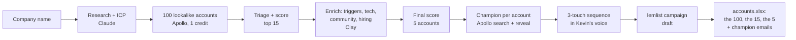

# Outbound Agent

Give it a company name. Every week it finds 5 new accounts that company should sell to, the champion at each one with a verified email, and builds the 3-touch outbound sequence in lemlist.



## How it works

| Stage | What happens | Tool | Cost |
|---|---|---|---|
| 0 | Run folder, connectors, accounts already pitched in earlier weeks | lemlist | 0 |
| 1–2 | Research the company, write the ICP (headline, two firmographic tracks, pain, check against customers, 5 funnel stages) plus segments, Apollo filters, scoring weights, champion titles | Claude | 0 |
| 3 | One company search for 100 lookalikes, minus the company's customers, competitors and anything already pitched | Apollo | 1 credit |
| 4 | Read every account (segment, what they sell, or why it is out), score on firmographics and headcount growth, shortlist 15 | Claude + `agent/score.py` | 0 |
| 5 | Enrich the shortlist: a dated trigger from the last 6 months, docs and support tech, community channels, whether they already run an AI assistant, relevant hiring, fit score | Clay (web research when Clay is not connected) | Clay credits |
| 6 | Final score, pick 5 with a dated trigger, mix segments; write "why they fit" and the trigger line | `agent/score.py` + Claude | 0 |
| 7 | Find the champion at each account (free search), reveal the 5 emails; an account with no champion gives its seat to the next | Apollo | ≤5 credits |
| 8 | Write Touch 1 (Day 1, the trigger), Touch 2 (Day 3, a proof story), Touch 3 (Day 5, close the loop) per champion, lint the voice | Claude + `agent/voice.py` | 0 |
| 9 | Build the lemlist campaign, steps driven by per-lead variables, add the 5 leads | lemlist | 0 |
| 10 | `accounts.xlsx` (the 100, the 15 and the 5, with how each was scored), `leads.csv`, the emails and the report in Word and Markdown | `agent/report.py` | 0 |

At most 6 Apollo credits a run. The lemlist campaign is built and loaded but never launched: the emails are written as the company's BDR, and I don't work there yet.

### What you get

`accounts.xlsx` in the run folder, one tab per step of the funnel:

| Tab | What is in it |
|---|---|
| Top 5 | The accounts table: #, Account, Type, Why they fit, Trigger, Champion, Contact, then the detail (email status, trigger date and source, the champion's LinkedIn, the closest customer, the score and how it scored) |
| Top 15 | The shortlist that was researched: what they do, the best trigger, tech, community, hiring, the scores, and the result (picked, or why not: no dated trigger, segment full, already a customer, tied to a competitor) |
| All 100 | Every company the Apollo search found, with how far it got and why it stopped there |
| How they were picked | The funnel step by step, the scoring rules with this ICP's weights, the segments and the ICP |

Next to it: `leads.csv`, and the emails and the report in Word (`emails.docx`, one account per page, and `report.docx`) and in Markdown. They hold the champions' emails, so they stay in `runs/` with the rest.

## Run it

### The dashboard

```
python3 -m venv .venv && .venv/bin/pip install -r requirements.txt
.venv/bin/python -m agent dashboard
```

It opens http://127.0.0.1:8765. Add the Apollo and lemlist keys with **Edit keys** (they go into `.env`, which git ignores), click **Check connections**, enter a company and start a run. Claude needs no key: the agent uses Claude Code, signed in on your Claude plan. While it runs you see each stage and the live log; when it is done, the funnel, the 5 leads (open one for why it fits, the trigger's source and its 3 emails), downloads in Excel, CSV and Word, what to check, Apollo credits and Claude cost, and whether the lemlist campaign is a draft. A run that stopped on an error shows the error and a **Resume run** button. The **⋯** next to a run deletes it (its folder on this machine; the lemlist campaign and the saved ICP stay, so the next run still skips those accounts) or makes the company's run start again every week. The dashboard listens on your machine only and needs the token it hands its own page, since the run folders hold real people's emails.

### Every week, on its own

**⋯ → Run every week** picks a day and a time (Monday 09:00 by default). On a Mac that is a LaunchAgent in `~/Library/LaunchAgents` (on Linux a crontab line) that runs `python -m agent scheduled "<company>"`: today's run, logged in its run folder, so the dashboard shows it like any other. Each week brings 5 new accounts, since the accounts already in the lemlist campaign are skipped, for at most 6 Apollo credits, and the campaign stays a draft. The computer has to be on: a Mac that is asleep at that time runs it when it wakes up, one that is off skips that week. **⋯ → Stop the weekly runs** removes it.

### On its own, from the terminal (no Claude Code)

```
python3 -m venv .venv && .venv/bin/pip install -r requirements.txt
export APOLLO_API_KEY=...      # company search, people search, email reveal (or put both keys in .env)
export LEMLIST_API_KEY=...     # optional: without it the lemlist payloads are written but not loaded
.venv/bin/python -m agent check-keys      # free calls: is Claude Code signed in, do the keys work
.venv/bin/python -m agent run "Acme" --domain acme.dev
```

[`agent/pipeline.py`](agent/pipeline.py) runs stages 0 to 10 end to end. Claude does the judgement steps through Claude Code (`claude -p`) on your Claude plan: no API key, no per-call bill, and a run counts against the plan's usage limits. Each step is its own Claude Code session in an empty folder with your skills, plugins, hooks and CLAUDE.md switched off and no tools but web search and web fetch. To use the Claude API instead, set `OUTBOUND_CLAUDE=api` and `ANTHROPIC_API_KEY` (`OUTBOUND_MODEL` picks the model; the API mode reports its cost). Either way it uses web search for the research and the enrichment, and every answer goes through the same checks as the skill's (ICP shape, triage coverage, dated triggers with URLs, the rules for the picks, the voice lint); problems go back to Claude for a fix. Apollo and lemlist are called through their REST APIs ([`agent/apollo.py`](agent/apollo.py), [`agent/lemlist.py`](agent/lemlist.py)), and the hard rules are in the code, not the prompt: the Apollo client refuses any paid call past 6 credits and has no phone, waterfall or enrich method; the lemlist client has no start, launch or lead-review method and adds every lead with lemlist enrichment off; the run stops before adding a lead unless the campaign reads draft with no senders.

Every stage writes its file in the run folder and is skipped when the file is there, so a run that stops halfway is picked up by running the same command again, without paying Apollo twice. Enrichment is web research, plus Clay when you give it a Clay API key and the ID of a Clay function to run (Clay's API has no plain "enrich this domain" call: its functions, such as "Get Funding and Expansion Events", run by ID, and the ID is copied from Functions, then Details in Clay). The function runs once on the 15 shortlisted accounts, its results go to the research step as evidence, and the run reports the Clay credits it used; with only a key, Clay shows its credit balance and is not used. In lemlist the campaign is built with you as the sender (the mailbox that owns the key, or `LEMLIST_SENDER_EMAIL`), email 1 right away, email 2 two days later, email 3 two days after that, and it is never launched. The final message prints the 5 leads, the funnel, Apollo credits and balance, and Claude's searches and tokens (and its cost in API mode).

### In Claude Code

From this repo:

```
/outbound-agent Acme acme.dev
```

The skill is in [`.claude/skills/outbound-agent/SKILL.md`](.claude/skills/outbound-agent/SKILL.md). It needs the Apollo and lemlist connectors, and Clay for the enrichment step.

The Python in `agent/` does the steps that should not depend on judgement: parsing the Apollo result, dropping customers and repeats, scoring, checking the picks, rendering and linting the emails, building the lemlist payloads and the report.

```
python3 -m agent new "Acme" --domain acme.dev
python3 -m agent validate <run>
python3 -m agent longlist <run> <apollo-result-file>
python3 -m agent score <run> --stage pre
python3 -m agent enrich-merge <run> <run>/enrich/*.json --source clay
python3 -m agent score <run> --stage final
python3 -m agent check <run>
python3 -m agent champions <run> <apollo-match-file>
python3 -m agent sequence <run> render|lint|lemlist
python3 -m agent report <run>
```

Tests: `python3 -m unittest discover -s tests` (standard library only).

## Try it with your own keys

The repo holds code only: no keys, no runs, no company data. `.env`, `runs/` and `companies/` stay on the machine that made them (git ignores all three), so a copy of the repo starts empty and runs on your accounts:

1. `git clone https://github.com/bkevin04/Outbound-Agent && cd Outbound-Agent`
2. `python3 -m venv .venv && .venv/bin/pip install -r requirements.txt`
3. Install [Claude Code](https://claude.com/claude-code) and sign in (`claude`): the agent runs its Claude steps on your plan. Or set `OUTBOUND_CLAUDE=api` and your own `ANTHROPIC_API_KEY`.
4. `.venv/bin/python -m agent dashboard`, then **Edit keys**: your Apollo key, and lemlist and Clay if you use them. **Check connections** makes free calls only.

A run spends your credits (at most 6 Apollo credits) and builds the lemlist campaign in your account as a draft that never sends. The dashboard runs on your computer only (127.0.0.1, behind a token it hands its own page): nobody reaches it from GitHub or the internet.

## What is in the repo and what is not

- `companies/<slug>/icp.json`: the ICP, reused week to week. Git ignores it, so it stays on your machine.
- `runs/`: every run's files, including the champions' emails. Git ignores it, and nothing with a person's email goes anywhere else.
- `.env`: your API keys. Git ignores it, and the dashboard writes it readable by you only.
